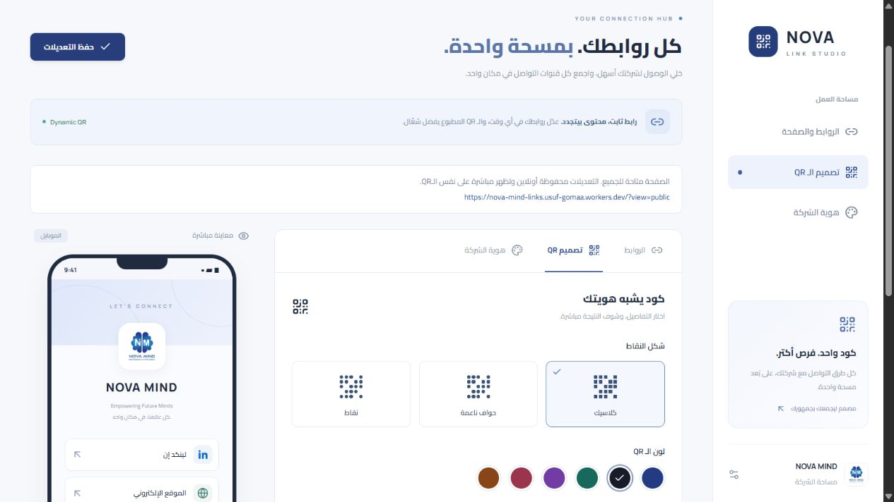
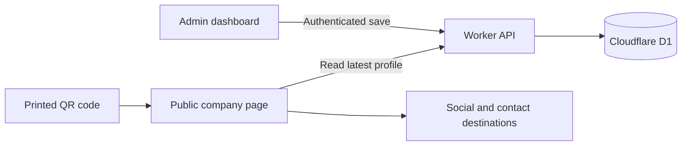

# Nova Mind Link Studio

A full-stack company link hub that connects one persistent QR code to a mobile-friendly page of social accounts and contact links. An authenticated dashboard lets the owner manage content and customize the QR without reprinting it whenever links change.

**Live application:** [nova-mind-links.usuf-gomaa.workers.dev](https://nova-mind-links.usuf-gomaa.workers.dev/)

> The live deployment belongs to NOVA MIND. This repository contains the application source, not its administrator password, production records, or Cloudflare credentials.



## Overview

Printed QR codes become inconvenient when the destination changes. Link Studio encodes the address of a stable landing page; that page reads the latest saved company profile. The owner can update individual destinations while keeping the same printed QR code.

The project supports three deployment modes:

- **Local:** Vite serves the dashboard and a Node.js middleware API; records persist in a JSON file on the computer.
- **Hosted:** Cloudflare Workers serves the application and API, with persistent storage in Cloudflare D1 and a password-protected admin dashboard.
- **Static snapshot:** A GitHub Pages-compatible export displays the last exported profile. Editing remains local and requires rebuilding and republishing the snapshot.

## Features

- Responsive Arabic interface with right-to-left layout and a mobile profile preview.
- Social and contact links with platform icons: Facebook, Instagram, LinkedIn, websites, WhatsApp, email, phone, and custom destinations.
- Create, edit, reorder, show, hide, and delete links.
- Debounced automatic saving with visible validation and save status.
- Public profile refreshes every three seconds in local and hosted modes.
- QR customization: square, rounded, and dotted modules, color selection, and a company logo in the center.
- PNG and SVG export using high error correction and a 1200 × 1200 rendering canvas.
- QR download verifies that at least one visible link exists and that saving succeeds in dynamic modes.
- Hosted authentication with HMAC-signed sessions, secure cookies, server-side write authorization, and login attempt limits.

## Technology stack

| Layer | Technologies | Purpose |
| --- | --- | --- |
| Frontend | React 19, TypeScript, Vite 8 | Dashboard, profile page, and development/build tooling |
| Styling | CSS, Tailwind CSS 4, Cairo and Manrope fonts | Responsive presentation and RTL interface |
| Icons and QR | Lucide React, custom SVG platform icons, qr-code-styling | Link identity and branded QR exports |
| Validation | Zod | Shared profile validation for local and hosted APIs |
| Local backend | Node.js, Vite middleware, filesystem APIs | Persistent local editing and LAN access |
| Hosted backend | Cloudflare Workers, Web Crypto API | HTTP API, authentication, and static assets |
| Database | Cloudflare D1 / SQLite | Hosted profile and login attempt records |
| Testing and delivery | Node.js test runner, TypeScript compiler, Wrangler, GitHub Actions | Automated checks and reproducible builds/deployment |

## Architecture



The QR stores the landing-page URL, not a serialized copy of the links. Dynamic updates work as long as that public URL remains unchanged. Local mode substitutes filesystem persistence for D1 and restricts writes to loopback requests.

## Getting started

### Prerequisites

- Node.js **22.13.0 or newer**; Node.js 22 LTS is used by CI.
- npm.
- A Cloudflare account only if deploying the hosted mode.

### Run locally

```bash
npm ci
npm run dev
```

Open `http://localhost:5173/` to manage the profile. Add the actual company links, then wait for the saved status. Local data is written to `data/profile.json`, which is intentionally excluded from Git.

On Windows, `Start-Local.bat` starts the same development server after dependencies have been installed.

### Scan from a phone

Use a phone on the same network and keep the local server running. The dashboard detects a network address for the QR; verify the displayed address if the computer has multiple adapters or a VPN. A local QR cannot work outside the network or after the server is stopped. Network isolation and firewall settings can also prevent phone access.

## Available commands

| Command | Description |
| --- | --- |
| `npm run dev` | Start the local editor and middleware API |
| `npm run check` | Check TypeScript without emitting files |
| `npm test` | Run local persistence and hosted authentication/API tests |
| `npm run test:hosted` | Run hosted backend tests only |
| `npm run build` | Build the local-mode frontend into `dist/` |
| `npm start` | Serve the built frontend with the local API |
| `npm run build:hosted` | Build the frontend for public and authenticated hosted routes |
| `npm run deploy:hosted` | Apply D1 migrations, import initial data, deploy, and upload the admin secret |
| `npm run build:pages` | Export a static profile snapshot for Pages-compatible hosting |

## Hosted deployment

1. Save a profile locally with at least one enabled destination.
2. Authenticate with Cloudflare:

   ```bash
   npx wrangler login
   npx wrangler d1 create nova-mind-links --config wrangler.json
   ```

3. Replace `REPLACE_WITH_YOUR_D1_DATABASE_ID` in `wrangler.json` with the returned ID. Set a unique Worker name if necessary. The published configuration contains no production account binding.
4. Create `.env.hosting.json` from `hosting/secrets.example.json` and set a strong administrator password. This file is ignored by Git. If it does not exist, the deployment script generates a random password locally.
5. Deploy:

   ```bash
   npm run deploy:hosted
   ```

6. Open `/admin` on the deployed origin, sign in, and download a new QR for that internet address. A previously exported local QR continues to point to its old LAN address.

The deployment script imports the local profile only if no hosted profile exists. Subsequent deployments preserve edits made in the online dashboard. See [hosting documentation](hosting/README.md) for credential rotation and operational details.

### Hosted routes

| Route | Access | Description |
| --- | --- | --- |
| `/` | Public | Company link page |
| `/admin` | Authenticated | Link management and QR customization |
| `/login` | Public | Administrator login form |
| `GET /api/profile` | Public | Read the company profile |
| `PUT /api/profile` | Authenticated | Validate and save the profile |
| `POST /api/login` | Public, rate limited | Verify the admin password and issue a session cookie |
| `POST /api/logout` | Same-origin | Clear the browser session cookie |
| `GET /api/session` | Public | Report whether the current browser is authenticated |

## Static hosting / GitHub Pages

```bash
npm run build:pages
```

This exports the saved local profile and frontend to `dist/`. Serve those files using a static host. The static build disables dashboard saving: changes require editing locally, rebuilding, and republishing to the same address. GitHub Pages alone does not provide the dynamic API or a hosted database.

The exported `profile.json` is public content. Never put secrets in profile fields.

## Security model

- Only authenticated hosted requests can modify the profile; hiding the dashboard link is not the authorization mechanism.
- Sessions are HMAC-SHA-256 signed, expire after 12 hours, and use `HttpOnly`, `Secure`, and `SameSite=Strict` cookies.
- Password rotation invalidates previously issued sessions. Logout clears the current browser cookie; it is not a server-side session revocation mechanism.
- Mutating hosted requests require a matching `Origin` header to mitigate CSRF.
- Login attempts are limited to ten per 15-minute window per hashed client IP.
- Profile inputs are validated with Zod, request bodies are bounded, and link protocols are restricted to HTTP(S), `mailto:`, and `tel:`.
- Production secrets belong in Cloudflare secrets, not source files, client code, or screenshots.
- Local editing is designed for a trusted computer/LAN and does not replace hosted authentication.

## Tests and CI

```bash
npm run check
npm test
npm run build
npm run build:hosted
```

Tests cover local persistence, blank unused links, invalid URL protocols, remote/cross-origin write rejection, signed session verification, password rotation, anonymous write blocking, authenticated updates, login throttling, and logout cookies.

GitHub Actions runs the same checks for pushes and pull requests. It does not deploy or require production credentials. `hosting/smoke.mjs` is an optional owner-operated live verification script; it uses the ignored local secret and saves the same existing profile to test persistence.

## Repository structure

```text
app/                 Dashboard component and styles
local/               React entry point, login UI, local API, and API tests
lib/                 Shared profile validation
hosting/             Worker backend, migrations, tests, and deployment helpers
public/              Company logo and public assets
docs/screenshots/    Product preview
scripts/             Local environment helpers for Wrangler
.github/workflows/   Continuous integration
wrangler.json        Portable Cloudflare deployment configuration
```

## Limitations

- A single company profile and one shared administrator credential; no multi-tenant accounts or role management.
- No scan analytics, link-click analytics, or custom-domain provisioning.
- The current validation limits the profile to 50 links and the uploaded logo to supported raster formats.
- Local persistence must be backed up separately; hosted backups should follow the database owner's operational policy.
- Availability and usage limits depend on the selected hosting provider and plan.

## Contributing and ownership

Use a focused branch and pull request, describe the behavior change, and run the checks before submission. Do not commit `.env*`, `.dev.vars*`, `data/`, `.wrangler/`, build output, or deployment secrets.

The application was built for NOVA MIND. Company branding remains the property of its owner. No open-source license is granted by publication alone; obtain permission before redistributing the project or branding.
